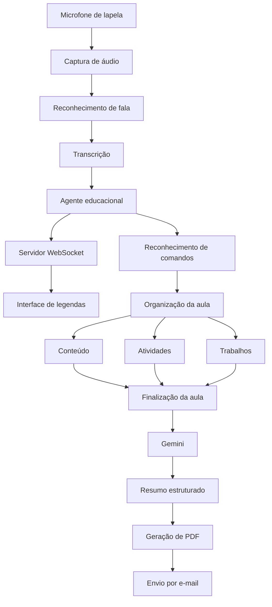
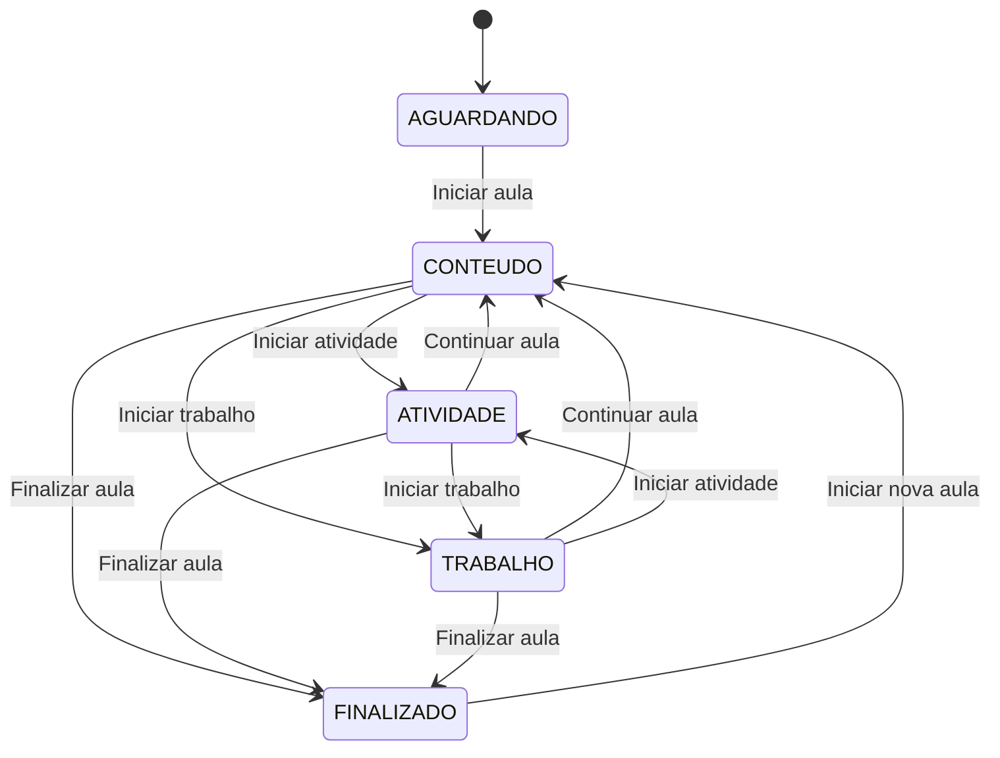

# Agente de IA para Acessibilidade Educacional

Projeto desenvolvido para a disciplina de **Interação Humano-Computador (IHC)** do Instituto Federal do Paraná — IFPR.

**Grupo 4:** Thiago e Breno.

**Status:** 🚧 Em desenvolvimento.

---

## 📖 Sobre o projeto

O projeto consiste no desenvolvimento de um agente de inteligência artificial voltado à acessibilidade educacional, utilizando uma TV Box B13 com Debian 13 Minimal.

O agente será responsável por capturar a fala do professor durante as aulas, gerar legendas em tempo real e organizar o conteúdo apresentado.

Ao finalizar a aula, o sistema utilizará inteligência artificial para produzir um resumo estruturado, gerar um documento PDF e enviá-lo por e-mail aos alunos cadastrados.

O objetivo principal é proporcionar maior acessibilidade aos estudantes, especialmente aqueles com deficiência auditiva ou dificuldades para acompanhar explicações e realizar anotações simultaneamente.

---

## 🎯 Objetivos

### Objetivo geral

Desenvolver um agente inteligente capaz de auxiliar estudantes no acompanhamento e na revisão de aulas presenciais, utilizando reconhecimento de voz, legendagem e geração automatizada de materiais de estudo.

### Objetivos específicos

- Capturar o áudio do professor utilizando um microfone de lapela.
- Converter a fala em texto.
- Exibir legendas em tempo real.
- Identificar comandos de voz.
- Organizar o conteúdo das aulas.
- Separar atividades e trabalhos.
- Gerar resumos utilizando inteligência artificial.
- Produzir relatórios em PDF.
- Enviar os materiais por e-mail.
- Automatizar a inicialização do sistema na TV Box.

---

## 🖥️ Hardware utilizado

| Equipamento | Finalidade |
|---|---|
| TV Box B13 | Executar e hospedar o agente |
| Debian 13 Minimal | Sistema operacional |
| Microfone de lapela | Capturar a fala do professor |
| Tablet ou smartphone | Exibir as legendas e acessar a interface |
| Conexão com a internet | Integração com IA e envio de e-mails |

A TV Box será utilizada como hardware principal do projeto, disponibilizando os serviços necessários para o funcionamento do agente.

O desenvolvimento inicial será realizado no Ubuntu, seguido da implantação e validação no Debian da TV Box.

---

## 🚀 Tecnologias utilizadas

| Tecnologia | Finalidade |
|---|---|
| Python | Desenvolvimento do backend |
| FastAPI | Servidor web e API |
| WebSocket | Comunicação em tempo real |
| Vosk | Reconhecimento de comandos |
| Parakeet / Whisper | Transcrição de áudio |
| Gemini | Processamento e geração de resumos |
| ReportLab | Geração de documentos PDF |
| SMTP | Envio de e-mails |
| HTML | Estrutura da interface |
| CSS | Estilização da interface |
| JavaScript | Comunicação e atualização das legendas |
| systemd | Inicialização automática |
| Git e GitHub | Versionamento do projeto |

A escolha definitiva do modelo de transcrição dependerá dos testes de desempenho e compatibilidade com a TV Box B13.

---

## 🧠 Arquitetura do sistema



O sistema será dividido em módulos independentes, permitindo manutenção, testes e futuras melhorias.

A geração de resumos não deverá impedir o funcionamento das legendas em tempo real.

---

## 🎙️ Comandos de voz

O professor poderá controlar o agente utilizando comandos específicos durante a aula.

| Comando | Ação |
|---|---|
| Iniciar aula | Inicia uma nova sessão de aula |
| Iniciar atividade | Registra as próximas falas como instruções de atividade |
| Iniciar trabalho | Registra as próximas falas como instruções de trabalho |
| Continuar aula | Retorna ao registro do conteúdo normal |
| Finalizar aula | Encerra a sessão e inicia a geração do resumo |

Os comandos serão reconhecidos por meio da transcrição e interpretados pelo agente.

A utilização de frases completas, em vez de palavras isoladas, tem como objetivo reduzir ativações acidentais durante as explicações.

---

## 🔄 Estados da aula

O agente funcionará utilizando estados para identificar o tipo de conteúdo apresentado pelo professor.



### AGUARDANDO

O sistema permanece disponível para reconhecer o comando de início da aula.

Nenhum conteúdo didático é registrado nesse estado.

### CONTEÚDO

Estado principal da aula.

As falas do professor são registradas como conteúdo educacional e disponibilizadas na interface de legendagem.

### ATIVIDADE

As instruções apresentadas pelo professor são armazenadas separadamente como atividades.

### TRABALHO

As orientações relacionadas a trabalhos acadêmicos são armazenadas em uma seção específica.

### FINALIZADO

O agente encerra o registro da aula e inicia o processamento do conteúdo para gerar o material de estudo.

---

## 📁 Estrutura do projeto

```text
trabalho_IHC/
│
├── robo/
│   ├── __init__.py
│   ├── agente.py
│   ├── aula.py
│   ├── comandos.py
│   ├── config.py
│   ├── cerebro.py
│   ├── ouvido.py
│   ├── transcricao.py
│   ├── servidor.py
│   ├── marcas.py
│   ├── pdf.py
│   └── email.py
│
├── ferramentas/
│   ├── automatico.py
│   └── baixar_modelos.py
│
├── interface/
│   ├── index.html
│   ├── style.css
│   └── script.js
│
├── dados/
│   ├── transcricoes/
│   └── relatorios/
│
├── modelos/
│
├── .env
├── .env.example
├── .gitignore
├── install.txt
├── install.sh
├── LICENSE
├── NOTICE
└── README.md
```

---

## ⚙️ Responsabilidade dos módulos

### `agente.py`

Núcleo principal do sistema.

Responsável por integrar os módulos de captura, transcrição, comandos, gerenciamento de aulas, geração de resumos e envio dos materiais.

### `aula.py`

Responsável pelo gerenciamento das sessões de aula.

Principais funções:

- Iniciar uma sessão.
- Controlar os estados da aula.
- Armazenar os conteúdos.
- Separar atividades e trabalhos.
- Finalizar a sessão.
- Preservar o histórico da aula.

### `comandos.py`

Responsável por identificar os comandos presentes nas transcrições.

Realiza a normalização do texto e verifica se o comando recebido é válido para o estado atual da aula.

### `config.py`

Centraliza as configurações do sistema.

Responsável por:

- Configurações de áudio.
- Configurações dos modelos.
- Variáveis de ambiente.
- Endereços e portas do servidor.
- Credenciais de serviços externos.
- Configurações de e-mail.

### `ouvido.py`

Responsável pela captura de áudio.

Será adaptado para realizar a escuta contínua durante as aulas, utilizando o microfone de lapela.

### `transcricao.py`

Responsável pela conversão da fala em texto.

Utilizará os modelos de reconhecimento de fala compatíveis com o hardware.

### `cerebro.py`

Responsável pela integração com a inteligência artificial.

Receberá a transcrição organizada da aula e solicitará a geração de um resumo educacional.

### `servidor.py`

Responsável por disponibilizar a API e a interface web.

Utilizará FastAPI e WebSocket para transmitir as legendas em tempo real.

### `marcas.py`

Módulo reaproveitado do projeto original.

Responsável pelo processamento de marcações utilizadas pelo cérebro do agente.

### `pdf.py`

Responsável pela geração do documento PDF.

O documento conterá os assuntos apresentados, os conceitos importantes, as atividades e os trabalhos solicitados.

### `email.py`

Responsável pelo envio do material gerado aos alunos autorizados.

Utilizará SMTP para realizar o envio dos documentos.

### `automatico.py`

Responsável por auxiliar na inicialização automática do sistema e na integração com dispositivos complementares.

### `baixar_modelos.py`

Responsável pela instalação e preparação dos modelos de reconhecimento de fala.

---

## 📄 Geração do material de estudo

Após o professor executar o comando de finalização, o agente deverá:

1. Encerrar o registro da aula.
2. Organizar os conteúdos armazenados.
3. Separar atividades e trabalhos.
4. Enviar as informações para a inteligência artificial.
5. Receber o resumo estruturado.
6. Gerar o documento PDF.
7. Enviar o documento por e-mail.

### Estrutura do PDF

O material de estudo deverá conter:

- Identificação da aula.
- Data da aula.
- Resumo geral.
- Principais conceitos apresentados.
- Explicações importantes.
- Atividades solicitadas.
- Trabalhos solicitados.
- Prazos e requisitos mencionados pelo professor.
- Pontos importantes para revisão.

A inteligência artificial deverá utilizar exclusivamente as informações presentes na transcrição, evitando inventar conteúdos, atividades ou prazos.

Caso alguma informação esteja incompleta, o documento deverá indicar a necessidade de confirmação.

---

## 📦 Instalação

### Pré-requisitos

- Python 3.
- Git.
- Ubuntu ou Debian.
- Conexão com a internet.
- Microfone compatível.
- Chave de API do Gemini.

### Clonar o repositório

```bash
git clone URL_DO_REPOSITORIO
```

```bash
cd trabalho_IHC
```

### Instalar dependências do sistema

```bash
sudo apt update

sudo apt install -y \
    python3 \
    python3-pip \
    python3-venv \
    ffmpeg \
    libportaudio2 \
    portaudio19-dev \
    git
```

### Criar ambiente virtual

```bash
python3 -m venv .venv
```

### Ativar ambiente virtual

```bash
source .venv/bin/activate
```

### Instalar bibliotecas Python

```bash
pip install -r install.txt
```

### Instalação automática

O projeto disponibilizará um script para automatizar a instalação das dependências.

```bash
chmod +x install.sh
```

```bash
./install.sh
```

A instalação e o download dos modelos de reconhecimento de fala serão validados na TV Box antes da implantação definitiva.

---

## 🔑 Configuração das variáveis de ambiente

O projeto utiliza um arquivo `.env` para armazenar as credenciais e configurações privadas.

Crie o arquivo:

```bash
nano .env
```

Exemplo de configuração:

```env
# Inteligencia Artificial

GEMINI_API_KEY=SUA_CHAVE_API
GEMINI_MODEL=MODELO_DISPONIVEL

# Servidor

HOST=0.0.0.0
PORT=8000

# Email

SMTP_HOST=smtp.gmail.com
SMTP_PORT=587
SMTP_USER=SEU_EMAIL
SMTP_PASSWORD=SUA_SENHA_DE_APLICATIVO

# Agente

AGENT_NAME=Agente IHC
LANGUAGE=pt-BR
```

> Nunca compartilhe suas chaves de API ou senhas.

O arquivo `.env` não deverá ser enviado ao GitHub.

O arquivo `.env.example` será utilizado para disponibilizar um exemplo de configuração sem informações sensíveis.

---

## ▶️ Executando o projeto

Após a implementação e integração dos módulos, o servidor poderá ser iniciado utilizando:

```bash
source .venv/bin/activate
```

```bash
python -m robo.servidor
```

A interface web poderá ser acessada pelo navegador utilizando o endereço IP da TV Box e a porta configurada.

Exemplo:

```text
http://192.168.1.100:8000
```

O endereço apresentado é apenas um exemplo.

O comando de execução será validado após a conclusão do desenvolvimento.

---

## 📱 Interface de acessibilidade

A interface será desenvolvida considerando os princípios de Interação Humano-Computador.

Principais características:

- Legendas em tempo real.
- Interface simples e intuitiva.
- Fonte ajustável.
- Alto contraste.
- Identificação do estado atual da aula.
- Indicador de conexão.
- Indicador de captura de áudio.
- Feedback visual dos comandos.
- Controles manuais como alternativa aos comandos de voz.
- Compatibilidade com tablets e smartphones.

A interface deverá permitir que os estudantes acompanhem o conteúdo apresentado sem depender exclusivamente da comunicação oral.

---

## ♿ Princípios de IHC aplicados

### Acessibilidade

Disponibilização das informações faladas em formato textual, reduzindo barreiras de acesso ao conteúdo educacional.

### Usabilidade

Interface objetiva, organizada e com facilidade de utilização.

### Feedback

O sistema deverá informar ao usuário seu estado atual, incluindo início da aula, reconhecimento de comandos, processamento e finalização.

### Consistência

Os componentes visuais deverão seguir padrões de apresentação e comportamento.

### Prevenção de erros

Os comandos serão validados antes de alterar o estado da aula.

O sistema deverá evitar registros inconsistentes e a geração duplicada de relatórios.

### Flexibilidade

O agente poderá ser utilizado por estudantes com diferentes necessidades, oferecendo recursos complementares de acompanhamento e revisão.

---

## 🔒 Segurança e privacidade

O projeto deverá respeitar a privacidade dos professores e estudantes.

Medidas previstas:

- Armazenamento das credenciais no `.env`.
- Proteção das chaves de API.
- Exclusão de dados privados do repositório.
- Controle de acesso às transcrições.
- Envio de materiais apenas aos destinatários autorizados.
- Informação aos participantes sobre a captura de áudio.
- Definição de procedimentos para exclusão dos dados.
- Utilização de conexões seguras quando necessário.

As transcrições, gravações, documentos gerados e informações dos alunos não deverão ser enviados ao GitHub.

Os materiais produzidos pela inteligência artificial poderão apresentar erros e deverão ser passíveis de revisão.

---

## 📋 Etapas de desenvolvimento

### Planejamento

- [x] Definir a proposta do projeto.
- [x] Definir o hardware utilizado.
- [x] Definir os comandos de voz.
- [x] Receber a TV Box com Debian configurado.
- [x] Definir a arquitetura inicial.
- [x] Criar a estrutura do projeto.
- [x] Selecionar os módulos reaproveitados.
- [x] Configurar a chave de API no `.env`.

### Desenvolvimento

- [ ] Implementar o gerenciamento de aulas.
- [ ] Implementar o reconhecimento de comandos.
- [ ] Implementar o núcleo do agente.
- [ ] Adaptar a captura de áudio.
- [ ] Adaptar o reconhecimento de fala.
- [ ] Adaptar as configurações do projeto original.
- [ ] Integrar a inteligência artificial.
- [ ] Implementar o servidor web.
- [ ] Desenvolver a interface de legendagem.
- [ ] Implementar a geração de PDF.
- [ ] Implementar o envio de e-mails.

### Testes e implantação

- [ ] Testar o funcionamento no Ubuntu.
- [ ] Testar a identificação dos comandos.
- [ ] Testar as transições de estado.
- [ ] Testar a qualidade das legendas.
- [ ] Testar a geração dos resumos.
- [ ] Testar a geração dos documentos PDF.
- [ ] Testar o envio de e-mails.
- [ ] Publicar o projeto no GitHub.
- [ ] Instalar o agente na TV Box B13.
- [ ] Validar o desempenho no Debian.
- [ ] Configurar a inicialização automática.
- [ ] Realizar testes de usabilidade e acessibilidade.
- [ ] Preparar a apresentação final.

---

## 👥 Divisão de responsabilidades

| Integrante | Responsabilidades |
|---|---|
| Thiago | Desenvolvimento do software, configuração do hardware, integração dos componentes, inteligência artificial e implantação |
| Breno | Disponibilização do microfone de lapela e apresentação do projeto |

---

## 🔮 Melhorias futuras

- Identificação automática da disciplina.
- Reconhecimento de múltiplos professores.
- Histórico de aulas.
- Cadastro de estudantes.
- Painel administrativo.
- Pesquisa nas transcrições.
- Exportação de conteúdos em outros formatos.
- Suporte a diferentes idiomas.
- Geração de exercícios de revisão.
- Integração com plataformas educacionais.
- Personalização das legendas por estudante.
- Disponibilização dos materiais em uma plataforma web.

---

## 📚 Projeto de referência

Este projeto utiliza como referência o **Robô Byte para TV Box B13**, desenvolvido por Marcos Roque da Rosa.

Foram selecionados módulos do projeto original para reaproveitamento e adaptação ao contexto de acessibilidade educacional.

### Módulos reaproveitados

- `automatico.py`
- `config.py`
- `ouvido.py`
- `transcricao.py`
- `cerebro.py`
- `servidor.py`
- `marcas.py`
- `baixar_modelos.py`

Repositório original:

https://github.com/marcosroquerosa/robo-assistente-b13

Os módulos serão adaptados conforme as necessidades do agente educacional.

Este projeto não constitui uma versão oficial do Robô Byte.

---

## 📜 Licença

O projeto original utiliza a licença Apache 2.0.

Os arquivos `LICENSE` e `NOTICE` deverão ser preservados, assim como os créditos do desenvolvedor original.

As alterações realizadas nos arquivos reaproveitados deverão ser identificadas conforme os termos da licença.

---

## 🎓 Informações acadêmicas

**Instituição:** Instituto Federal do Paraná — IFPR.

**Curso:** Análise e Desenvolvimento de Sistemas.

**Disciplina:** Interação Humano-Computador.

**Grupo:** 4.

**Integrantes:** Thiago e Breno.

**Ano:** 2026.

---

## 💡 Considerações finais

O agente de inteligência artificial para acessibilidade educacional busca utilizar a tecnologia como ferramenta de inclusão, permitindo que estudantes acompanhem as aulas por meio de legendas em tempo real e tenham acesso a materiais de estudo gerados automaticamente.

A utilização da TV Box B13 demonstra a possibilidade de reaproveitamento de hardware para desenvolver soluções educacionais de baixo custo, integrando reconhecimento de fala, inteligência artificial e interfaces acessíveis.

O projeto encontra-se em desenvolvimento, e suas funcionalidades serão implementadas e validadas progressivamente.